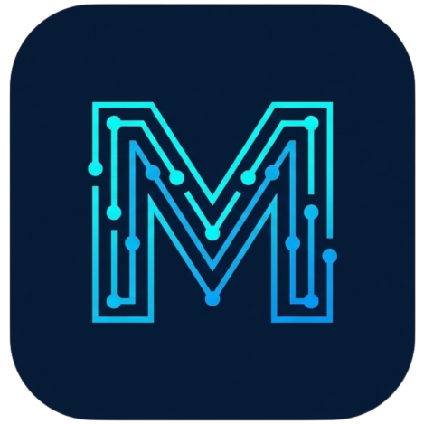

<p align="center">
  
</p>

<h1 align="center">MC-Panel (MCode Server & App Control Panel)</h1>

<p align="center">
  <strong>Ultra-lightweight, high-performance Linux Server & CBT App Control Daemon written in Go and Vue 3.</strong>
</p>

<p align="center">
  
  
  
  
  
</p>

---

## 🚀 Overview

**MC-Panel** adalah daemon server control panel generasi baru yang dirancang khusus untuk mengelola aplikasi **MC-ExamGO (Go CBT Core)**, **Laravel / PHP Apps**, dan **Reverse Proxy Workloads** dengan konsumsi memori yang luar biasa hemat (**< 20 MB RAM**), menggantikan panel server konvensional yang boros memori (500MB+ RAM).

Frontend Vue 3 SPA di-embed langsung ke dalam single binary executable Go (`//go:embed`), sehingga binary panel dapat langsung dijalankan tanpa ketergantungan pada runtime Node.js atau web server eksternal saat di-deploy di VPS.

---

## ✨ Fitur Utama (Key Features)

- ⚡ **Ultra Low Memory Footprint:** Konsumsi RAM panel di bawah 20 MB, sangat efisien untuk VPS hemat resource (1 vCPU, 1 GB RAM) hingga Server Baremetal CBT ratusan core.
- 📦 **Single-Binary Zero-Dependency:** Seluruh asset frontend SPA dikompilasi langsung ke dalam satu binary standalone Go.
- 🎯 **Dukungan Workload Lengkap:**
  - **Go Apps (MC-ExamGO):** Manajemen systemd daemon terisolasi, port auto-allocation (anti-collision), dan reverse proxy Nginx otomatis.
  - **Laravel & Modern PHP Apps:** FastCGI passing Nginx, permission auto-fix www-data/nginx, serta helper database provisioning.
  - **Reverse Proxy Engine:** Dukungan reverse proxy serbaguna (Next.js, Node.js, Python FastAPI, Flask, Docker) dengan WebSocket stream aktif & timeout 600s.
- 🐘 **Multi-PHP Engine & Legacy Support (PHP 7.0 - 8.5):**
  - Mendukung penuh PHP modern (**8.5, 8.4, 8.3, 8.2, 8.1, 8.0**) hingga aplikasi ujian/CMS legacy era lama (**7.4, 7.3, 7.2, 7.1, 7.0** seperti Candy CBT, BeeSMART, Moodle).
  - Auto-start service PHP-FPM dan auto-regenerate Nginx vhost socket saat versi PHP diganti.
- 🎛️ **Enterprise PHP & MySQL RAM Tuner:**
  - **PHP Tuner:** Preset cepat (*CBT High-Traffic 1024M / 10000 vars*, *Modern Web*, *Lightweight*), 1-Click Extension Switcher (`phpenmod`/`phpdismod`), serta editor raw `php.ini` & `www.conf`.
  - **MySQL Tuner:** Preset alokasi buffer pool RAM (`64M`, `256M`, `1024M`) dan optimasi `performance_schema` hemat memori.
- 🗄️ **Database Multi-Engine Provisioner:**
  - Pembuatan user & database terisolasi otomatis untuk **PostgreSQL (16 / 17 / 18)** dan **MySQL / MariaDB**.
- 🔒 **One-Click SSL & Firewall Multi-Adapter:**
  - Auto-issue dan auto-renew Let's Encrypt SSL via Certbot.
  - Dukungan firewall otomatis untuk **UFW** (Debian/Ubuntu) dan **Firewalld** (RHEL/AlmaLinux/CentOS).
- 🔄 **1-Click Auto-Updater:** Pembaruan versi in-place langsung dari GitHub Releases tanpa downtime.
- 📊 **Live Telemetry & Service Supervisor:** Monitoring real-time CPU, RAM, Disk, Uptime, serta supervise status service Linux (Active, Inactive, Failed, Memory RSS).

---

## 🛠️ Tech Stack & Compatibility

| Komponen | Teknologi |
| :--- | :--- |
| **Backend Engine** | Go 1.22+, Gin Framework, GORM, Pure-Go modernc SQLite, gopsutil |
| **Frontend Dashboard** | Vue 3 (Composition API `<script setup>`), Vite, Tailwind CSS, Lucide Icons, Pinia |
| **Database Supported** | PostgreSQL 16.x / 17.x / 18.x, MySQL 8.x / MariaDB 10.x, SQLite |
| **Supported OS (Universal)** | • **Ubuntu** 20.04 / 22.04 / 24.04 LTS<br>• **Debian** 10 / 11 / 12<br>• **AlmaLinux** 8 / 9 & **Rocky Linux** 8 / 9<br>• **CentOS** 7 / 8 / 9 Stream & **RHEL** 8 / 9 |

---

## 🚀 Instalasi Cepat (Universal One-Line Installer)

Jalankan perintah berikut di terminal SSH VPS Anda sebagai user `root` (otomatis mendeteksi OS Ubuntu, Debian, AlmaLinux, Rocky, maupun CentOS):

```bash
curl -sSL https://raw.githubusercontent.com/maulanacod3/MC-Panel-Relase/main/install.sh | bash
```

Setelah instalasi selesai, buka browser di:
👉 **`http://IP_VPS_ANDA:9090`**
- **Default User:** `admin`
- **Default Password:** `admin123`

---

## 💻 Local Development & Build

### 1. Jalankan Backend (Go)
```bash
cd backend
go run cmd/server/main.go
```

### 2. Jalankan Frontend (Vite)
```bash
cd frontend
npm install
npm run dev
```

### 3. Build Single Binary (Multi-Platform)
```powershell
# Windows PowerShell
.\scripts\build.ps1
```
```bash
# Linux Bash
./scripts/build.sh
```

Binary hasil build akan otomatis tersedia di direktori `bin/`:
- `bin/mc-panel.exe` (Windows Binary)
- `bin/mc-panel-linux-amd64` (Linux Standalone Binary)

---

## 📄 License
Project ini dilisensikan di bawah lisensi [MIT](LICENSE).
